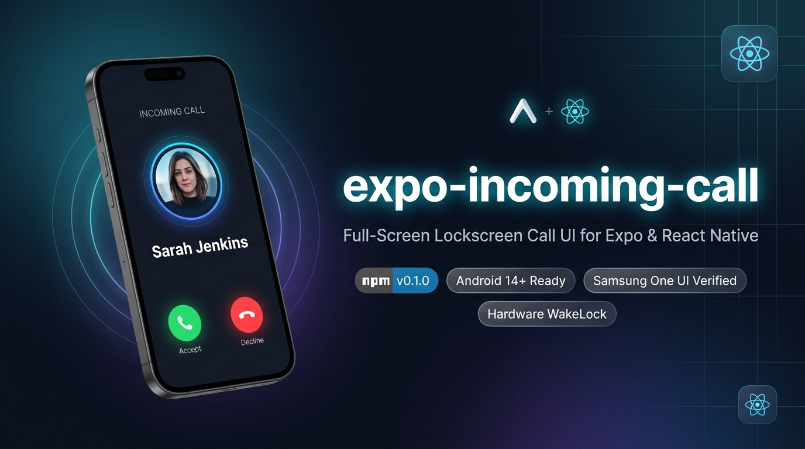

# expo-incoming-call 📞

<p align="center">
  
</p>

**Full-screen incoming call UI and lock screen takeover for Expo (React Native) apps on Android.**

Provides a native, WhatsApp-style incoming call experience that wakes the physical screen from sleep, displays directly over the lockscreen without requiring a PIN or password, plays looping ringtone audio, and provides Accept & Decline buttons — even when the app is killed in the background.

---

## 🌟 Features

- **Lock Screen Takeover**: Directly displays over the lockscreen without unlocking or entering a password (`showWhenLocked="true"` and `turnScreenOn="true"`).
- **Physical Screen Wake**: Acquires a hardware `PowerManager` WakeLock to turn the physical display on the instant a call arrives.
- **Samsung One UI & OEM Compatibility**: Sets critical window flags before layout inflation to work reliably on Samsung Galaxy, Xiaomi, Oppo, Vivo, and Google Pixel devices.
- **Loud Looping Ringtone**: Plays system ringtone audio via `STREAM_RING` and `USAGE_NOTIFICATION_RINGTONE`, unaffected by standard notification mute rules.
- **Config Plugin Included**: Auto-configures all necessary Android permissions and activity declarations via `app.json` — zero manual Java/Kotlin coding.
- **Android 14+ Ready**: Fully compatible with Android 14 `USE_FULL_SCREEN_INTENT` restrictions.

---

## 📦 Installation

```bash
npx expo install expo-incoming-call
```

---

## ⚙️ Configuration (Expo Config Plugin)

Add `expo-incoming-call` to your `plugins` array in `app.json` or `app.config.js`:

```json
{
  "expo": {
    "plugins": [
      [
        "expo-incoming-call",
        {
          "channelId": "incoming_calls",
          "channelName": "Incoming Calls",
          "accentColor": "#2563EB"
        }
      ]
    ]
  }
}
```

Then generate your native project code using Expo Prebuild:

```bash
npx expo prebuild
```

---

## 🚀 Usage

### 1. Display an Incoming Call

Call `displayIncomingCall` from your JavaScript code or background push notification handler:

```ts
import { displayIncomingCall } from 'expo-incoming-call';

await displayIncomingCall({
  uuid: 'call-session-9876',
  callerName: 'Sarah Jenkins',
  callType: 'Incoming Audio Call',
  subtitle: 'My App Name',
  accentColor: '#2563EB',
  timeoutSeconds: 30,
  // Custom payload passed to your app when answered
  roomId: 'room-101',
  callerId: 'user-456',
});
```

### 2. Dismiss an Active Call

If the caller hangs up before the user answers, dismiss the call screen programmatically:

```ts
import { dismissCall } from 'expo-incoming-call';

await dismissCall();
```

### 3. Listen for User Actions (Accept / Decline)

Subscribe to call events in your root component or call screen:

```tsx
import React, { useEffect } from 'react';
import {
  addCallAnsweredListener,
  addCallDeclinedListener,
  addCallTimeoutListener,
  getPendingAnsweredCall,
  clearPendingAnsweredCall,
} from 'expo-incoming-call';

export default function App() {
  useEffect(() => {
    // Check if the app was launched by tapping "Accept" while killed
    const pendingCall = getPendingAnsweredCall();
    if (pendingCall) {
      console.log('App launched from accepted call:', pendingCall);
      clearPendingAnsweredCall();
      // Navigate to your Active Call Screen / WebRTC room
    }

    // Listener when user accepts call while app is in foreground/background
    const answeredSub = addCallAnsweredListener((event) => {
      console.log('User accepted call:', event);
      // Navigate to call room
    });

    // Listener when user declines call
    const declinedSub = addCallDeclinedListener((event) => {
      console.log('User declined call:', event);
    });

    // Listener when call rings for 30s without answer
    const timeoutSub = addCallTimeoutListener((event) => {
      console.log('Call timed out:', event);
    });

    return () => {
      answeredSub.remove();
      declinedSub.remove();
      timeoutSub.remove();
    };
  }, []);

  return <YourAppNavigation />;
}
```

---

### 4. Android 14+ Permission Check & Heads-Up Fallback

On Android 14 (API 34), Google restricts `USE_FULL_SCREEN_INTENT` by default unless granted or qualified under Google Play's Calling/Alarm policy.

`expo-incoming-call` handles this out of the box:
- **Permission Granted**: Wakes screen and launches the full-screen lockscreen takeover.
- **Permission Denied / Revoked**: Automatically falls back to a high-priority Heads-Up notification banner with interactive **Accept** and **Decline** action buttons.

You can also check the permission status at runtime and deep-link users directly to the settings page:

```tsx
import { canUseFullScreenIntent, openFullScreenIntentSettings } from 'expo-incoming-call';

const isAllowed = canUseFullScreenIntent();
if (!isAllowed) {
  // Opens Android's system settings to grant Full Screen Intent access
  openFullScreenIntentSettings();
}
```

---

## 🔔 Waking Killed Apps from FCM (Firebase Cloud Messaging)

To wake an Android device from a killed state, your server **must send a high-priority data-only message** (do NOT include a top-level `notification` key in the FCM payload, as the Android system tray will intercept it):

### Example Backend FCM Payload (Node.js):

```js
const admin = require('firebase-admin');

await admin.messaging().send({
  token: targetFcmToken,
  android: {
    priority: 'high',
  },
  data: {
    type: 'INCOMING_CALL',
    uuid: 'call-session-1234',
    callerName: 'Sarah Jenkins',
    callType: 'Voice Call',
  },
});
```

---

## 📱 OEM Device Settings Checklist (Samsung, Xiaomi, etc.)

Some Android manufacturers apply aggressive battery management that can restrict background activity launches:

1. **Battery Optimization**: Set your app's Battery usage to **Unrestricted** in Android App Info.
2. **Special App Access**: Ensure **Full Screen Intent** permission is toggled to **Allowed** under *Settings > Apps > Special App Access > Full Screen Intents*.

---

## 📄 License

MIT © [Harshit Nakrani](https://github.com/Harshitnakrani)
